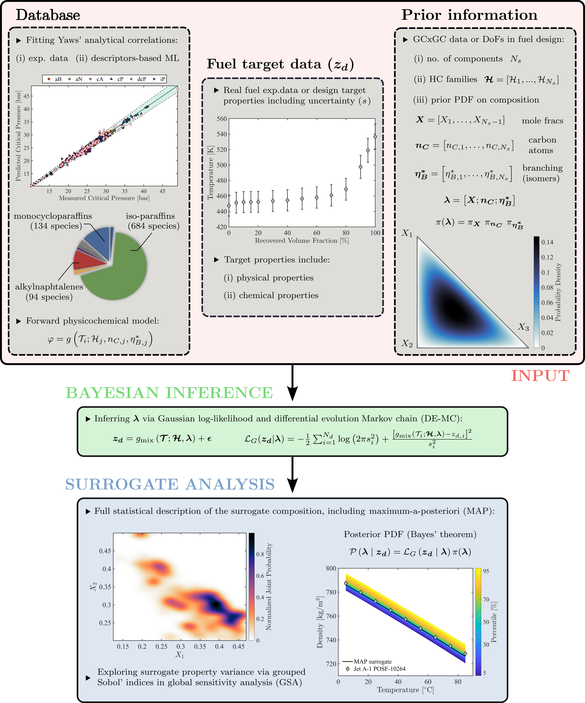
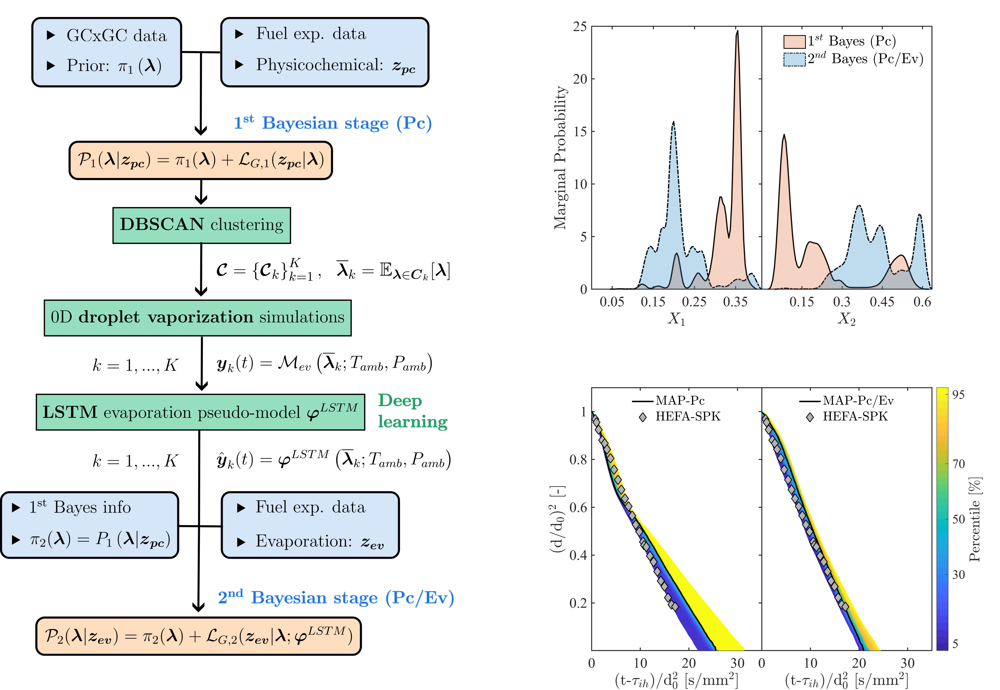
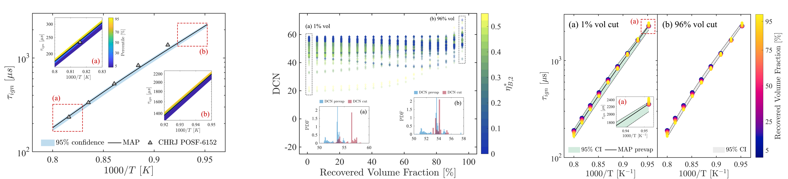

# BayeSAF: Emulation and Design of Sustainable Alternative Fuels via Bayesian Inference and Descriptors-Based Machine Learning

<p align="center">
  
</p>

As part of mid-century net-zero carbon neutrality pathways, sustainable aviation fuels (SAFs) constitute the only viable decarbonization strategy for commercial aviation in the foreseeable future. Still, reliable prescreening of alternative jet fuels is crucial in facilitating the de-risking and scale-up of SAF production technologies. In this context, _BayeSAF_ constitutes an innovative methodology to support the physicochemical characterization of emerging SAFs and to understand the impact on combustor operability figures of merit (FOM).


**_BayeSAF_ framework**: workflow description. An innovative methodology for formulating physicochemical surrogate mixtures that emulate the properties of real jet fuel or drive alternative jet fuel design processes is proposed. First, an extensive hydrocarbon property database (992 chemical compounds from 7 hydrocarbon molecular groups) encompassing individual components of candidate SAFs based on available experimental measurements and descriptors-based machine learning (DB-ML) techniques is developed, addressing: (i) 11 bulk properties (molecular weight _M_, critical temperature T<sub>c</sub>, critical pressure P<sub>c</sub>, critical molar volume V<sub>c</sub>, critical density ρ<sub>c</sub>, critical compressibility factor Ζ<sub>c</sub>, acentric factor ω, derived cetane number DCN, lower heating value LHV, flash point T<sub>f</sub>, and freezing point T<sub>fz</sub>); 7 temperature-dependent thermophysical properties (liquid-phase density ρ<sub>l</sub>, liquid-phase dynamic viscosity μ<sub>l</sub>, liquid-phase isobaric specific heat C<sub>p,l</sub>, liquid-phase thermal conductivity k<sub>l</sub>, vapor pressure p<sub>v</sub>, surface tension σ, and latent heat of vaporization H<sub>v</sub>). Thereafter, the _BayeSAF_ algorithm resorts to the hydrocarbon property database and Bayesian inference techniques to formulate surrogate mixtures for alternative jet fuel emulation and design. 

**<u>USER-DEFINED INPUTS<u>** 

(i) target physicochemical properties (real fuel emulation or jet fuel design)        
(ii) number of surrogate mixture components, N<sub>s</sub>             
(iii) corresponding hydrocarbon molecular groups, ℋ

**What is _BayeSAF_ inferring then?**

_BayeSAF_ infers **λ** = [**X**; **n<sub>C</sub>**; **η<sub>Β</sub><sup>*</sup>**], i.e., a set of (3N<sub>s</sub>-1) compositional parameters - molar fractions, carbon atom counts, and normalized topochemical atom indices for branching - that univocally identifies mixtures comprising chemical compounds from the hydrocarbon property database. 

**What can I do to promote fast convergence?**

Setting informative prior probability density functions (PDFs) for the compositional parameters **λ**, based on GCxGC for real fuel emulation or chemical composition requirements from ASTM standards for jet fuel design.

**<u>OUTPUT<u>**

On the one hand, the primary outcome of the _BayeSAF_ algorithm is the most probable surrogate mixture composition in terms of molar proportions, carbon atom counts, and isomeric conformations, also referred to as the _maximum-a-posteriori_ (MAP) surrogate mixture. On the other hand, as the posterior PDF inherently provides a statistical description of the surrogate composition, a variance-based global sensitivity analysis (GSA) about the impact of individual groups of compositional parameters on the variance in key physicochemical properties might be carried out by resorting to grouped first-order Sobol' indices.

# Repository layout

```
matlab/      MATLAB implementation
  examples/CHRJ_3comp/    end-to-end example (three-component surrogate of the CHRJ fuel)
  mcmc/ pdfs/ thermo-transport/ distillation/ postprocessing/ gsa/ utilities/
python/      Python implementation (installable package `bayesaf`)
  src/bayesaf/            same modules as the MATLAB version
  examples/CHRJ_3comp/    the same example in Python
database/    hydrocarbon property database: 7 molecular groups, one folder each
exp/         experimental targets of the real fuel (CHRJ_POSF6152)
docs/        documentation of the MATLAB and Python implementations
img/         figures used in this README
```

The MATLAB and Python versions implement the same method and share `database/` and `exp/`.

# Requirements

| | |
|---|---|
| **MATLAB** | MATLAB R2022b or later with the Parallel Computing, the Statistics and Machine Learning and the Optimization Toolboxes (parallel pool, kernel density estimates, quantiles and sampling, boiling temperatures) |
| **Python** | Python 3.9 or later; `numpy`, `scipy`, `pandas`, `matplotlib` and `numba` (installed automatically with the package) |

# Quick start

Both examples build a three-component surrogate of the HEFA-SPK fuel POSF-6152 (CHRJ), run the sampler, find the MAP surrogate, propagate the posterior to the target properties and plot the results.

**MATLAB.** Open `matlab/examples/CHRJ_3comp/example_HEFA.m`, make that folder the current folder (the example adds the other folders to the path with relative paths) and run it.

**Python.**

```bash
cd python
pip install -e ".[dev]"
cd examples/CHRJ_3comp
python example_hefa.py
```

Run the Python example from its own folder, and install in editable mode (`-e`) from a clone: the package finds `database/` relative to its source files.

Each run writes, in the folder of the example:

| File | Content |
|---|---|
| `MAP.txt` | maximum-a-posteriori surrogate: species, molar/mass/volume fractions, blend properties (H/C, DCN, flash point, freezing point, LHV, pseudo-critical properties) |
| `MCMC.txt` (MATLAB), `demc_log.txt` (Python) | log of the sampler: burn-in, outlier-chain resets, convergence and effective sample size |
| `Figures/` | chains, acceptance rate and R-hat, posterior marginals and joint distributions, property checks against the data, sensitivity indices |
| `CHRJ_3comp.mat` (MATLAB) | workspace of the run |

The sampler stops when the R-hat statistic is below the threshold at consecutive checks. The bulk effective sample size of the molar fractions is computed at the end of every run and reported as a diagnostic, with a warning if it is below `ess_min`. A run that reaches `maxIterations` without meeting the R-hat criterion has not converged: increase the number of iterations.

# Using your own fuel

1. Put one CSV per measured property in a new folder `exp/<FUEL>/` (values and standard deviations; temperature-dependent properties and the distillation curve have their own columns).
2. In the example, set the list of properties, the folder, the fuel name and the bubble temperature of the fuel (`1e+18` if unknown).
3. Choose the number of components, the hydrocarbon group and the range of carbon atoms of each, and the bounds on the molar fractions. Informative bounds (for instance from GCxGC) speed up convergence.
4. Run the example. Check the R-hat and effective-sample-size output before using the results.

The file formats and the units are in [`docs/Input-data.md`](docs/Input-data.md); every sampler parameter is documented for [Python](docs/python/Configuration-reference.md) and for [MATLAB](docs/matlab/Configuration-reference.md).

# Documentation

The `docs/` folder describes both implementations in detail, starting from [`docs/README.md`](docs/README.md):

* how to use the code: [Python quick start](docs/python/Quick-start.md) and [MATLAB quick start](docs/matlab/Quick-start.md), [input data](docs/Input-data.md), the configuration reference of [Python](docs/python/Configuration-reference.md) and of [MATLAB](docs/matlab/Configuration-reference.md);
* what the code does: [parametrisation](docs/Notation-and-parametrisation.md), [Bayesian model](docs/Bayesian-model.md), [thermophysical models](docs/Thermophysical-models.md), [sampler](docs/Sampler.md) and [references](docs/References.md);
* [differences between the Python and MATLAB implementations](docs/Differences-Python-MATLAB.md).

# Objectives

The _BayeSAF_ framework constitutes a robust methodology for carrying out alternative jet fuel emulation and design through the development of ad-hoc physicochemical surrogate mixtures that address the entirety of the target properties specified within the ASTM D1655 standard, which regulates the specifications for aviation turbine fuels. Notably, the Bayesian-inference-based surrogate formulation process provides a complete statistical description of the mixture composition, which might subsequently drive forward uncertainty quantification (UQ) in multi-fidelity numerical analyses - ranging from zero- and one-dimensional reduced-order models (ROMs) for vaporization and combustion characterization to three-dimensional reacting computational fluid dynamics (CFD) targeting preferential vaporization effects in realistic aeronautical combustion chambers - of SAF-fueled combustion systems, providing pushforward distributions of combustor operability figures of merit (FOM). In conclusion, _BayeSAF_ provides an end-to-end multi-fidelity modeling framework that may support fuel design and pre-screening of novel SAFs, facilitate the de-risking of emerging SAF production pathways, and alleviate existing barriers to the scale-up of the SAF industry.

# How to cite

Liberatori J., Cavalieri D., Blandino M., Valorani M., and Ciottoli P.P., _BayeSAF: Emulation and Design of Sustainable Alternative Fuels via Bayesian Inference and Descriptors-Based Machine Learning_, Fuel 419, 138835 (2026), https://doi.org/10.1016/j.fuel.2026.138835.

```
@article{liberatori2026bayesaf,
  author  = {Liberatori, Jacopo and Cavalieri, Davide and Blandino, Matteo and Valorani, Mauro and Ciottoli, Pietro Paolo},
  title   = {{BayeSAF: Emulation and design of sustainable alternative fuels via Bayesian inference and descriptors-based machine learning}},
  journal = {Fuel},
  year    = {2026},
  volume  = {419},
  pages   = {138835},
  doi     = {10.1016/j.fuel.2026.138835}
}
```

# Example application no. 1: uncertainty quantification of SAF evaporation

Liberatori J., Cavalieri D., Blandino M., Iavarone S., Ciottoli P.P., and Vicquelin, R., _Deep-learning-based sequential Bayesian updating and uncertainty quantification of vaporization of aviation fuel surrogates: a case study on HEFA-SPK_, Journal of Engineering for Gas Turbines and Power 148.10, 101012, doi: 10.1115/1.4072456 (2026).


# Example application no. 2: uncertainty quantification of SAF combustion

Liberatori J., Iavarone S., and Vicquelin, R., _Bayesian uncertainty quantification of the ignition behavior of a HEFA-SPK surrogate_, Proceedings of the Combustion Institute 42, 106140, doi:10.1016/j.proci.2026.106140 (2026).



Copyright (C) 2026 Jacopo Liberatori - All Rights Reserved. You may use, distribute, and modify this code under the terms of Prosperity Public License.
