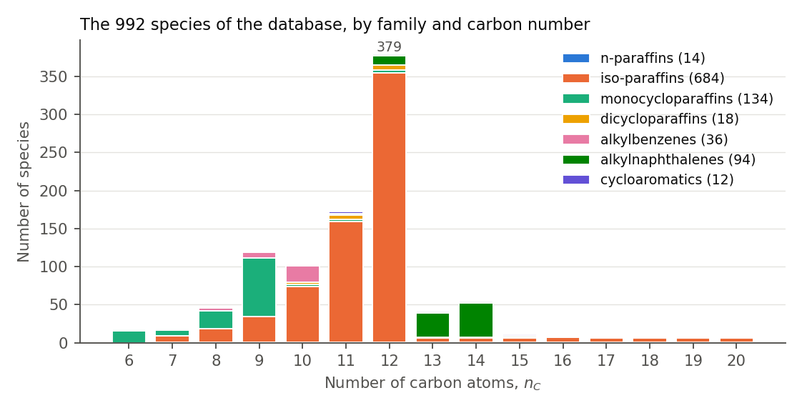
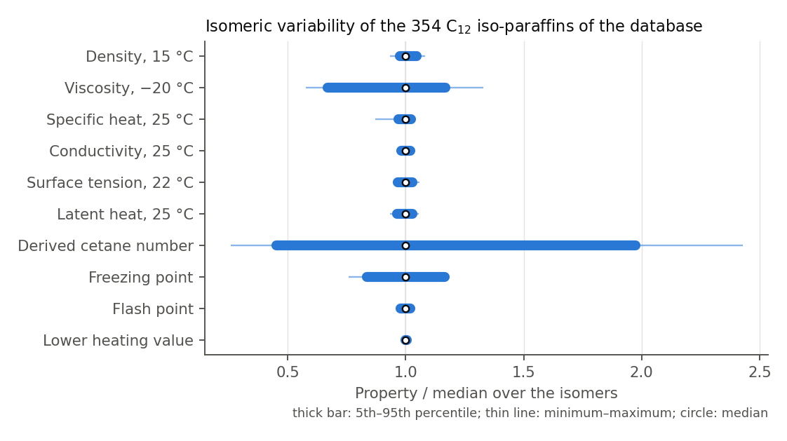

# Input data

> **Names.** This page uses the Python names. In MATLAB: `DATASET` is `Dataset` (a cell array of names without extension), `DATA_DIR` does not exist (the files are found on the
> MATLAB path), `FAMILIES` is `families`, `N_RANGES` is `n_ranges`, `T_BUBBLE` is `Tbubble_realFuel`. The file formats are the same. The
> notes specific to MATLAB are at the end of the page.

## Species database (`database/`)

One directory per hydrocarbon family. The directory name and the family key used in the code are:

| Family key in `FAMILIES` | Directory | Notes |
|---|---|---|
| `nparaffins` | `nparaffins/` | |
| `isoparaffins` | `isoparaffins/` | |
| `cycloparaffins` | `cycloparaffins/` | |
| `dicycloparaffins` | `dicycloparaffins/` | |
| `alkylbenzenes` | `alkylbenzenes/` | |
| `alkylnaphthalenes` | `alkylnaphthalenes/` | |
| `cycloaromatics` | `cycloaromatics/` | |

Each directory contains three semicolon-separated CSV files:

| File | Content |
|---|---|
| `<family>_MatlabData.csv` | the data read by `load_hydrocarbons` |
| `<family>_Names.csv` | `Name; eta_B_star; eta_B_star_norm`, row-aligned with the data file |
| `<family>_SMILES.csv` | SMILES of each species |

### What the database contains

The database has 992 species of seven hydrocarbon families, up to 20 carbon atoms:

| Family | Species | `n_C` range |
|---|---|---|
| n-paraffins (`nparaffins`) | 14 | 7-20 |
| iso-paraffins (`isoparaffins`) | 684 | 7-20 |
| monocycloparaffins (`cycloparaffins`) | 134 | 6-12 |
| dicycloparaffins (`dicycloparaffins`) | 18 | 10-15 |
| alkylbenzenes (`alkylbenzenes`) | 36 | 6-10 |
| alkylnaphthalenes (`alkylnaphthalenes`) | 94 | 10-15 |
| cycloaromatics (`cycloaromatics`) | 12 | 9-15 |



The iso-paraffins carry most of the isomeric information: there are 354 isomers at `n_C = 12`, and from
`n_C = 13` on five (six at `n_C = 16`) per carbon number. Isomers of the same carbon number differ
noticeably in several properties:



*Spread of ten properties over the 354 C12 iso-paraffins of the database, relative to the median. The temperature-dependent
properties are computed from the Yaws coefficients of the database at the temperatures shown. Freezing and flash points are in kelvin.*

**Branching index.** `eta_B_star` is the product of the topochemical atom index for branching `η_B` ([Roy and Ghosh 2004](References.md#database-and-topochemical-index); computed with PaDEL, [Yap 2011](References.md#database-and-topochemical-index)) and the molecular (van der Waals) volume `V_W` of a conformer (RDKit, [Bento et al. 2020](References.md#database-and-topochemical-index)). The isomeric effects were studied with this index by [Hall et al. (2024)](References.md#database-and-topochemical-index). The normalised value is `η*_B = (BI - BI_min) / (BI_max - BI_min)`, with the extremes taken over the species of the same family with the same `n_C`. Families with one species per carbon number (n-paraffins) have a constant `η*_B`.

**Provenance of the values.** For every species the files give 11 bulk properties (`W`, `Tc`, `Pc`, `Vc`, `rhoc`, `Zc`, `omega`, `Tf`, `Tfz`, `Hc`, `DCN`) and the Yaws coefficients of the seven temperature-dependent properties. The values come from the Yaws' handbook ([Yaws 2003](References.md#thermophysical-and-mixing-models)) and from other experimental references where available. Missing values were predicted with descriptors-based machine-learning models (elastic net, LASSO, gradient boosting, support vector regression, random forest or multi-layer perceptron; see [Liberatori et al. 2026](References.md#statistical-model-and-the-paper), Sec. 2.1, and [Freitas and Jiang 2024](References.md#database-and-topochemical-index) for the approach). The derived cetane numbers are taken from [Murphy et al. (2004)](References.md#database-and-topochemical-index) where available and otherwise predicted by a Gaussian-process model trained on those data.

**Annotated tables.** Each family directory also contains `<family>.xlsx`, a table of the same values with the definition of every column, the formulas of the Yaws' correlations and the reference of each value. **Values predicted by machine learning are written in red**; the other values are experimental or taken from the references listed in the file. The code reads only the CSV files.

### Columns of `<family>_MatlabData.csv`

| Column | Meaning |
|---|---|
| `nC` | number of carbon atoms |
| `eta_B_star` | branching index `BI = η_B V_W` of the paper (topochemical atom index for branching times molecular volume) |
| `eta_B_star_norm` | `η*_B`: `eta_B_star` normalised to `[0, 1]` among the species of the same family and the same `n_C` |
| `W` | molecular weight [g/mol] |
| `Tc`, `Pc`, `Vc`, `rhoc`, `Zc`, `omega` | critical temperature [K], pressure, molar volume, density, compressibility factor, acentric factor |
| `Tf` | flash point [K] |
| `Tfz` | freezing point [K] |
| `Hc` | lower heating value [MJ/kg] |
| `Amu, Bmu, Cmu, Dmu` | Yaws coefficients, dynamic viscosity |
| `Arho, Brho, Crho` | liquid density |
| `Asat, Bsat, Csat, Dsat, Esat` | vapour pressure |
| `Ac, Bc, Cc, Dc` | liquid specific heat |
| `Ak, Bk, Ck` | thermal conductivity |
| `Avap, Bvap` | latent heat of vaporization |
| `Asigma, Bsigma` | surface tension |
| `DCN` | derived cetane number |

`load_hydrocarbons` reads `nC`, `eta_B_star`, `eta_B_star_norm`, `W`, `Tc`, the Yaws columns, `DCN`,
`Tf`, `Tfz` and `Hc`. The columns `Pc`, `Vc`, `rhoc`, `Zc` and `omega` are used only by the MAP
writer for the pseudo-critical properties. The correspondence of the Yaws coefficients with the
formulas is given in [Thermophysical models](Thermophysical-models.md).

The row order of `_Names.csv` must match `_MatlabData.csv`, because the MAP writer
looks up the species name by row position.

## Experimental targets (`exp/<FUEL>/`)

One CSV file per property, with a header line and comma-separated numeric columns.
`data_import` reads `data_dir/<name>.csv` for each entry of `DATASET`.

### Mapping from file name to property

The property is detected from the **file name by substring**, in this order (first match wins):

`deltaT_dist`, `distillation`, `molWeight`, `specificHeat`, `latentHeat`, `vaporPressure`, `kappa`,
`sigma`, `rho`, `mu`, `nu`, `HC`, `DCN`, `flash`, `freezing`, `LHV`.

So `rho_expA` is read as `rho`. A name that does not contain any of these strings raises `ValueError`.
A name that contains two keys takes the first one in this list (for example `mu_nu` is `mu`). Keep the names exact.

### Column layout

The columns are positional, not read by name.

| Property | Columns |
|---|---|
| `molWeight`, `HC`, `DCN`, `LHV`, `flash`, `freezing` | `value, std` |
| `rho`, `mu`, `nu`, `kappa`, `specificHeat`, `latentHeat`, `vaporPressure`, `sigma` | `T [K], value, std` |
| `distillation` | `recovered volume [%], T [K], std [K], pressure [Pa]` |
| `deltaT_dist` | `range code, deltaT [K], std [K], pressure [Pa]` |

Units of the value column must match the model: `rho` in kg/m3, `mu` in Pa s, `nu` in m2/s,
`kappa` in W/(m K), `specificHeat` in J/(kg K), `latentHeat` in J/kg, `vaporPressure` in Pa,
`sigma` in N/m, `LHV` in MJ/kg, `molWeight` in g/mol.

The `std` of scalar properties (`molWeight`, `HC`, `DCN`, `flash`, `freezing`, `LHV`) is column 1; for the other
properties it is column 2 (`pdfs/pdf_build.py`, `_std_data`).

`deltaT_dist` range codes: `5010` is `T50 - T10`, `9010` is `T90 - T10`. Rows with other codes
produce a model value of zero.

`distillation` volumes should be in the range 0-100 and ordered by increasing volume. The cheap
likelihood uses the **first row** of the file, so put there the data point that should act as
the filter (in the CHRJ example it is the 5% point).

### Distillation pressure

`p_distillation` reads the pressure from column 4 of the first row of the `distillation` file (or, if
absent, of `deltaT_dist`). If neither is in `DATASET` it uses 101325 Pa.

### Temperature filtering

For the temperature-dependent properties (`rho`, `mu`, `nu`, `kappa`, `specificHeat`, `latentHeat`,
`vaporPressure`, `sigma`), `data_import` discards the rows with `T >= 0.999 * T_threshold`, where

```
T_threshold = min(T_BUBBLE, lowest normal boiling temperature among all candidate species)
```

computed at the distillation pressure. If you do not know the bubble temperature of the real fuel,
set `T_BUBBLE = 1e18`: the threshold is then the lowest boiling temperature among the candidates.

Scalar properties and the two distillation datasets are not filtered.

### Returned structures

`data_import(...)` returns four lists with one element per entry of `DATASET`:

| Return | Content |
|---|---|
| `full_data` | numeric array of the (filtered) file |
| `min_T_array`, `max_T_array` | minimum and maximum of column 0, or of column 1 (the temperature) for `distillation` and `deltaT_dist` |
| `variable_names` | detected property names |

## Example (`exp/CHRJ_POSF6152/`)

```
rho.csv            T [K], rho [kg/m^3], std [kg/m^3]
distillation.csv   beta [-], T [K], std [K], pressure [Pa]
deltaT_dist.csv    range, deltaT [K], std [K], pressure [Pa]
molWeight.csv      MW [g/mol], std [g/mol]
HC.csv             HC [-], std [-]
DCN.csv            DCN [-], std [-]
LHV.csv            LHV [MJ/kg], std [MJ/kg]
flash.csv          flash [K], std [K]
```

## Checklist for a new fuel

1. One CSV per property, in the units above, with a `std` for every row.
2. At least one `distillation` or `deltaT_dist` file if you need a pressure other than 101325 Pa.
3. `DATASET` lists only files that exist in `DATA_DIR`.
4. A sensible `T_BUBBLE`.
5. The family and carbon range of each component cover the chemistry of the fuel. A range too narrow cannot be recovered by the inference.
6. Informative bounds on the molar fractions, if the composition is roughly known (for example from GCxGC), speed up convergence.

## MATLAB implementation: notes

- **Where the files are found.** MATLAB looks for the CSV files on the path. The examples add the folders of the database
  and `exp/<FUEL>/` with `addpath` (relative paths, so they must be run from the folder of the example). `Dataset` contains
  the file names **without extension** (`'rho'`, `'distillation'`, ...); `readtable` finds `rho.csv`.
- **Detection of the property.** `data_import` tests the name of each entry with `contains`, in the same order as the Python implementation
  (the list above): the first match decides, and a name that matches none stops with an error.
- **Minimum and maximum.** As in Python: `minT_array` and `maxT_array` come from column 1 (temperature) of `distillation` and `deltaT_dist`
  data and from column 0 for the other properties.
- **Pressure.** `p_distillation(Dataset)` reads column 4 of the first row of the file whose name contains `distillation`, or else
  `deltaT_dist`, and uses 101325 Pa if there is none.
- **Temperature threshold.** Same rule as in Python (`threshold_temperature.m`); the boiling temperatures are computed with `fsolve`.
- **Species database.** `Hydrocarbons.m` reads `<family>_MatlabData.csv` with `readtable`, so the folder of each family must be on the path.
