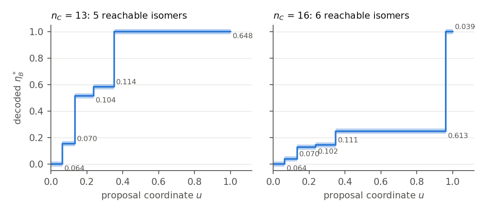

# Notation and parametrisation

> **Implementation map**
>
> | Concept | Python | MATLAB |
> |---|---|---|
> | Species list of a component | `load_hydrocarbons`, `Species` (`thermo_transport/hydrocarbons.py`) | `Hydrocarbons.m`; struct array with the fields `nC`, `eta_B_star`, `eta_B_star_norm`, `molWeight`, `Tc`, `coeffMu`, `coeffRho`, `coeffPsat`, `coeffK`, `coeffCl`, `coeffHv`, `coeffSigma`, `DCN`, `Tf`, `Tfz`, `Hc` |
> | Species lookup | `find_index_eta` | `findIndex_eta.m` |
> | Decoding, folding, cells | `mcmc/layout.py` | local functions of `DifferentialEvolutionMarkovChain.m`: `isomer_tables`, `decode_component`, `decode_rows`, `fold_fractions` |
> | Initial population | `SurrogateLayout.init_population` | initialisation block of `DifferentialEvolutionMarkovChain.m` (`pdist2` from the Statistics and Machine Learning Toolbox) |
>
> The parametrisation is the same in both implementations; see
> [Differences between the Python and MATLAB implementations](Differences-Python-MATLAB.md).

This page defines what is inferred and how the sampler represents it. It describes the code as
implemented in `python/src/bayesaf/mcmc/layout.py`, `utilities/find_index.py` and
`thermo_transport/hydrocarbons.py`.

## Notation

| Symbol | Meaning | Code |
|---|---|---|
| `N_s` | number of surrogate components | `NUM_COMPONENTS`, `num_components` |
| `𝓗 = [H_1, ..., H_{N_s}]` | hydrocarbon family of each component | `FAMILIES` |
| `X_j` | molar fraction of component `j` (`j = 1..N_s`), with `X_{N_s} = 1 - sum(X_j)`; only the first `N_s - 1` are inferred | `X_all`, `x_MAP` |
| `n_C,j` | number of carbon atoms of component `j` | `n_all`, `nc_MAP` |
| `η*_B,j` | normalised topochemical atom index for branching of component `j`: it identifies the isomer | `eta_B_star_all`, `eta_B_star_MAP` |
| `λ` | the vector of inferred parameters, `[X; n_C; η*_B]` | one row of `chain_reshaped` |
| species `(j, n_C, η*_B)` | one entry of the species list of component `j` | `Species` |
| `z_d`, `s_i` | target property values (measured or prescribed) and their standard deviations | files of `exp/<FUEL>/` |
| `𝒯`, `β_f` | thermodynamic states of the temperature-dependent targets, and recovered fractions of the distillation targets | temperature and volume columns of the data files |
| `g_mix` | forward model: species database and mixing rules | `mixture_property`, `distillation_curve`, ... |
| `π(λ)`, `𝓛_G(z_d ∣ λ)`, `𝒫(λ ∣ z_d)` | prior, Gaussian likelihood, posterior | `prior_fn`, `likelihood_fn`, `posterior_fn` |
| `x_i`, `β` | liquid mole fraction and vapour fraction in the flash problem; `x = X` at the start of the distillation | [Thermophysical models](Thermophysical-models.md) |
| `ϑ` | inverse temperature of a chain in the parallel-tempering ladder | `beta` in the sampler ([Sampler](Sampler.md)) |

The symbols follow the paper ([Liberatori et al. (2026)](References.md#statistical-model-and-the-paper)). Two things differ in the code:

- the array called `X` in the sampler holds the **normalised** state in `[0, 1]`; the molar fractions are in `phys`;
- `eta_B_star_norm` (`η*_B`) is the value used by the sampler and written to the output. The un-normalised
  `eta_B_star` is the branching index `BI` of the paper (`BI = η_B V_W`, see [Input data](Input-data.md#what-the-database-contains)),
  used only inside the decoder (see below).

## The inferred vector

```math
\lambda = [\,X_1,\dots,X_{N_s-1};\; n_{C,1},\dots,n_{C,N_s};\; \eta^*_{B,1},\dots,\eta^*_{B,N_s}\,]
```

It has `3*N_s - 1` entries. The column order is fixed by `SurrogateLayout`:

| Columns | Content |
|---|---|
| `0 .. N_s-2` | molar fractions (the last one is `1 - sum`) |
| `N_s-1 .. 2N_s-2` | carbon numbers |
| `2N_s-1 .. 3N_s-2` | normalised topochemical indices |

For component `j`, `(n_C, η*_B)` identifies one species of the family `FAMILIES[j]`. The pair is
mapped to a row of the database by `find_index_eta`: keep the species with the requested `n_C`,
then take the one whose `eta_B_star_norm` is closest to the requested value.

## The species list of a component

`load_hydrocarbons(family, nc_range)` reads `database/<family>/<family>_MatlabData.csv` (separator
`;`) and keeps the rows whose `nC` is in `nc_range`. The rows are ordered by `nc_range` first and by
file order within each `nC`. The result is a list of `Species` dataclasses with:

`nC`, `eta_B_star`, `eta_B_star_norm`, `mol_weight` [g/mol], `Tc` [K], the Yaws coefficient
arrays (`coeff_mu` 4, `coeff_rho` 3, `coeff_psat` 5, `coeff_k` 3, `coeff_cl` 4, `coeff_hv` 2,
`coeff_sigma` 2), `DCN`, `Tf` [K], `Tfz` [K], `Hc` [MJ/kg].

Two components can use the same family (as in the example, with two `isoparaffins` components over
different carbon ranges). Each component has its own list.

## Normalised coordinates and decoding

The DE-MC proposals are made in a state vector `X` with all entries in `[0, 1]`. A second array,
`phys`, holds the physical values. `phys` is what the posterior is evaluated on and what is
stored in the chain. The decoding rules are:

**Molar fractions.** `phys_j = X_j * (upper_j - lower_j) + lower_j`, with the bounds
`LOWER_MOL_FRAC` and `UPPER_MOL_FRAC`. Only the first `N_s - 1` fractions are in the state vector.

**Carbon number.** With `K` distinct carbon numbers available in the species list of the component
(`sorted({sp.nC})`), `u` in `[0, 1]` is mapped to the index `min(floor(u*K), K-1)`. Each carbon
number therefore has the same width `1/K` in `u`.

> The list of carbon numbers is taken from the species list, not from `N_RANGES`. If the database has no
> species for some `n` in `N_RANGES`, that `n` is not reachable.

**Isomer (`η*_B`).** Let `N` be the number of species in the whole list of the component (all carbon
numbers) and let `eta_sorted` be their `eta_B_star` values (un-normalised) sorted in increasing order.
For `u` in `[0, 1]`:

1. `idx = round(1 + u*(N-1)) - 1` (round half away from zero, clipped to `[0, N-1]`), so that
   `eta_target = eta_sorted[idx]`.
2. Among the species with the already decoded `n_C`, take the one whose `eta_B_star` is closest to
   `eta_target`, and return its `eta_B_star_norm`.

The decoding is deliberately identical to the MATLAB version.

### Decoder cells

Because step 2 maps many values of `u` to the same species, each isomer owns a *cell* in `u` whose
measure `m` depends on how the sorted `eta_B_star` list is distributed. `CompositionUnit.eta_cells`
computes these cells exactly. They are used for two things:

- the isomer prior correction (see [Bayesian model](Bayesian-model.md#prior));
- the exact Gibbs move, which needs the list of reachable isomers and a way to draw `u` uniformly
  inside the cell of a chosen isomer (`sample_u`).

Species whose cell has zero measure are **unreachable**: no `u` decodes to them. They are excluded
from the candidates and have `-inf` posterior.



*Decoder of the isomer index for the iso-paraffin component of the 992-species database (`isoparaffins`, `n_C` from 7 to 20), at two carbon numbers. Each step is one isomer; the number next to a step is the measure of its cell. The widths are unequal, so the isomers are not equally probable under a uniform proposal; the prior correction of the [Bayesian model](Bayesian-model.md#isomer-prior-correction-in-the-sampler) compensates for it.*

## Boundary handling

Proposals can leave `[0, 1]`.

- **Molar fractions** (`fold_fractions`): if `X < 0` the value becomes `max(1 - |X|, 0)`; if `X > 1`
  it becomes `min(|X - 1|, 1)`. Then `phys` is recomputed from the folded `X`.
- **Carbon number and isomer** (`decode_discrete`): a triangle-wave fold
  `1 - |1 - (x mod 2)|` reflects any real value into `[0, 1]`, then the decoding above is applied.
- **Closing fraction**: the last molar fraction is `1 - sum`. It must fall inside its own bounds. This
  is enforced by the prior (`-inf` otherwise) and, in the Gibbs move, by `fractions_sum_ok`.

## Initial population

`SurrogateLayout.init_population`:

1. Draw `Dirichlet(1)` vectors (via `-log(U)` normalised) in batches, and keep those whose `N_s`
   molar fractions lie inside the bounds. The target is `10 * N_chains` valid samples.
2. Normalise the first `N_s - 1` fractions to `[0, 1]` and draw the `2*N_s` coordinates of `n_C` and
   `η*_B` uniformly.
3. Decode and evaluate the posterior on all samples. Candidates with a non-finite log-posterior
   (for example `η*_B` outside `LOWER_ETA`/`UPPER_ETA`) are discarded and the draw is repeated until
   `10 * N_chains` finite candidates are available (error after 100 rounds). Then select `N_chains`
   points by a greedy max-min distance rule in physical space (first point random, then the point
   farthest from the selected ones).
4. Shuffle the order.

The initial population always uses a uniform Dirichlet, whatever `ALPHA_DIRICHLET` is. The initial
molar fractions are also required to satisfy the bounds on all `N_s` fractions. The `η*_B` coordinate
is drawn uniformly on [0, 1] regardless of the `η*_B` bounds; the bounds act through the prior, so the
finite-posterior filter above is what keeps the initial states inside them.

## Families with a constant isomer index

If every species of a family has the same `eta_B_star_norm` (for instance `nparaffins`, with one
isomer per carbon number), the `η*_B` column of that component is constant. It is excluded from the
R-hat test (`rhat_skip`) and appears as `NaN` in `R_hat`.

## MATLAB implementation: notes

- **Where the species are.** `Hydrocarbons(class, nc_range)` reads `<family>_MatlabData.csv` with `readtable`, looking for
  the file on the MATLAB path (the examples add the folders of `database/` to the path). The species are ordered by `nc_range`
  and then by row order in the file, as in Python. The files are read again at every call.
- **Decoding tables.** `isomer_tables(classes, n_ranges)` precomputes for each component, and for every carbon number in
  `n_ranges{k}`, the table `decode(rank, carbon index)` of `eta_B_star_norm` values. It is the same map as in Python: the
  rank of `u` in the class-wide sorted `eta_B_star` list, then the nearest isomer with that number of carbon atoms.
  The same call computes the cell measures and the log-prior correction.
- **Carbon numbers.** The decoding of `n_C` uses the **user's** `n_ranges{k}` (equal-width bins). Python uses the carbon
  numbers present in the loaded species list. The two coincide when every number in `n_ranges{k}` has at least one
  species in the database. If one does not, `Hydrocarbons` stops with an explicit error (`The database has no species of the family ... with ... carbon atoms`),
  where Python simply cannot reach that number.
- **Index base.** All column indices below are 1-based in MATLAB: the molar fractions are columns `1..N_s-1`
  (`cols_x`), the carbon numbers `N_s..2N_s-1` (`cols_nc`), the topochemical indices `2N_s..3N_s-1` (`cols_eta`).
- **Initial population.** Same procedure as in Python: Dirichlet(1) within the bounds, uniform coordinates for the rest,
  candidates with a non-finite log-posterior discarded, greedy max-min distance selection with `pdist2`, random permutation.
- **Family keys.** `Hydrocarbons.m` accepts `nparaffins`, `isoparaffins`, `cycloparaffins`, `dicycloparaffins`,
  `alkylbenzenes`, `alkylnaphthalenes` and `cycloaromatics`; the other modules use the same keys, and an unknown family stops with an error.
