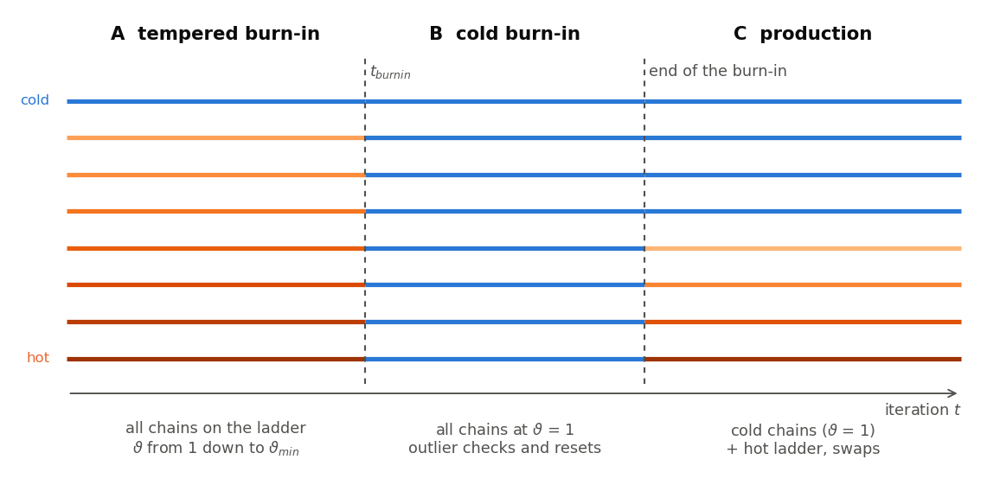

# Sampler (DE-MC)

> **Implementation map**
>
> | Concept | Python | MATLAB |
> |---|---|---|
> | Sampler | `run_demc` (`mcmc/demc.py`) | `DifferentialEvolutionMarkovChain.m` |
> | Parameter layout, decoding | `mcmc/layout.py` | local functions of the same file |
> | Classic R-hat | `_r_hat_classic` | `rhat_classic` (local function) |
> | Bulk effective sample size | `_ess_bulk` | `ess_bulk` (local function; `norminv`, `tiedrank` from the Statistics Toolbox) |
>
> Parameter names are the same, except for `scaling_factor_x`, `noise_x` (MATLAB: `scaling_factor_X`, `noise_X`) and the keyword arguments of Python versus the positional ones of MATLAB.
>
> The algorithm is the same in both implementations. The MATLAB sampler fixes several settings internally and has no
> enumeration option for the Gibbs move; see
> [Differences between the Python and MATLAB implementations](Differences-Python-MATLAB.md).

`mcmc/demc.py`, function `run_demc`. The algorithm is the Differential Evolution Markov Chain of
[ter Braak (2006)](References.md#sampling-and-convergence), adapted from the DREAM toolbox ([Vrugt 2016](References.md#sampling-and-convergence)), with parallel tempering ([Earl and Deem 2005](References.md#sampling-and-convergence)), delayed
acceptance, snooker moves, an exact multiple-try Gibbs move on `(n_C, η*_B)`, an adaptive burn-in
with outlier-chain resets, and a stopping rule on R-hat. The effective sample size is reported as a diagnostic.

## Overview of a run

```
initialise N_chains states            (init_population)
for t = 1 .. max_iterations-1:
    phase A  t <= t_burnin            parallel tempering on the whole ladder
    phase B  t > t_burnin, burn-in    all chains at ϑ = 1, outlier checks
    phase C  burn-in finished         production: cold chains + hot ladder
    for each chain: propose (Gibbs move or block DE/snooker move)
    stage 1: accept/reject with the cheap posterior
    stage 2: for survivors, correct with the full posterior
    parallel tempering swaps
    store state; check convergence
```

In the formulas of this page `ϑ` is the inverse temperature of a chain (`beta` in the code; the parameters are `beta_min` and `beta_min_sampling`). The symbol `β` is used for the vapour fraction of the flash problem ([Thermophysical models](Thermophysical-models.md#flash-equation)).



*Phases of a run. Each line is a chain; blue chains are at `ϑ = 1`, orange chains are on the tempering ladder (darker = hotter). The end of the burn-in is adaptive: it is not `t_burnin`.*

Everything is vectorised over chains where possible; the posterior callables receive the batch of
proposals.

## Random numbers

`np.random.RandomState(seed)` (MT19937). Normal variates use a Marsaglia-Tsang ziggurat built to
consume the Mersenne-Twister stream like MATLAB's `randn`, so that the Python and MATLAB versions
can be compared with the same seed. A given `seed` reproduces a run on the same machine and library versions.

## State and coordinates

The sampler carries two arrays for each chain: the normalised state `X` in `[0, 1]` where jumps are made
and the physical state `phys` where the posterior is evaluated ([Notation](Notation-and-parametrisation.md)).
The parameter vector has `n_params = 3*N_s - 1` entries and the chain array stores the **physical** values.

## Proposals

At each iteration and for each chain `i`, a number `r` in `[0, 1]` is drawn.

### Block DE move (probability `1 - p_gibbs`)

One of three blocks is chosen with equal probability: the molar fractions, the carbon numbers, or the
`η*_B` values. Only the columns of that block change:

```math
X'_j = X_{i,j} + (1 - \lambda)\,\gamma \sum_{d=1}^{D} (X_{a_d,j} - X_{b_d,j}) + \epsilon_j
```

- `a_d`, `b_d` are `D` pairs of other chains. `D` is uniform in `1..n_pairs`.
- `lambda` is uniform in `[-0.1, 0.1]` (one draw per chain per iteration).
- `gamma = scaling * 2.38 / sqrt(2 D d)`, with `d` the number of coordinates in the block (`N_s - 1` for
  fractions, `N_s` for `n_C` and `η*_B`). The `scaling` is `scaling_factor_x`, `scaling_factor_nc` or
  `scaling_factor_eta` depending on the block. With probability 0.1 the jump uses `gamma = 1`
  instead (mode jumping).
- `epsilon` is Gaussian noise of standard deviation `noise_x`, `noise_nc` or `noise_eta`.
- `scaling_factor_nc` can be an array (one value per component); the 10% `gamma = 1` switch is then
  drawn independently per element.
- Partners: during the burn-in they are drawn from all other chains; in production they are drawn from the
  chains of the same temperature group (cold or hot).

After the jump the proposal is folded back into `[0, 1]` and decoded ([Notation](Notation-and-parametrisation.md#boundary-handling)).

### Snooker move (probability `p_snooker` given the fractions block)

Because the block is chosen first, the snooker move is attempted with unconditional probability
`p_snooker / 3` per chain and iteration. It is used only for the molar-fraction block, only after
`t > t_burnin` and `t > 10 * n_params`, and only when the archive holds at least 3 stored states.
The archive stores the normalised state of every chain every 10 iterations.

The move projects a jump along the direction `z = X_R - X_i` pointing to another chain `R`:

```math
X'_i = X_i + \gamma_s\, \alpha z + \epsilon, \qquad \alpha = \frac{z \cdot v}{z \cdot z + 10^{-8}}
```

where `v` is the difference between two archived states of two other chains and
`gamma_s ~ U(1.2, 2.2)`. The Metropolis ratio includes the Jacobian correction of [ter Braak and
Vrugt (2008)](References.md#sampling-and-convergence), `(d-1) [log|z| - log|z'|]`, with `d` the number of fraction coordinates.

### Gibbs-type move (probability `p_gibbs`)

A multi-component move that is exact with respect to the discrete part:

1. Choose a component `k` uniformly.
2. **Molar fractions.** Take a symmetric DE jump of all the fractions with one partner pair
   (`gamma = scaling_factor_x * 2.38 / sqrt(2 (N_s-1))`, with the 10% switch to 1). If the implied last
   fraction is outside its bounds (`fractions_sum_ok` false) the proposal is rejected at stage 1.
3. **`(n_C, η*_B)` of component `k`.** Resample the pair according to the cheap posterior:
   - `gibbs_tries = None`: enumerate all reachable `(n_C, η*_B)` candidates of the component
     (`unit.candidates(k)`) and choose one with probability proportional to
     `exp(cheap posterior + log cell measure)`. The stage-1 ratio corrects for the move of the
     fractions by the ratio of the normalising constants of the forward and reverse
     conditionals.
   - `gibbs_tries = K`: multiple-try Metropolis ([Liu, Liang and Wong 2000](References.md#sampling-and-convergence)). Draw `K` uniform trial
     points in `u`, pick one with probability proportional to `exp(ϑ * cheap posterior)`, draw
     `K-1` reference points plus the current state for the reverse, and use the ratio of the sums of
     weights as the stage-1 acceptance ratio.

The Gibbs move overrides the generic stage-1 ratio of the chain with its own exact value
(`stage1_override`).

## Delayed acceptance

Stage 1 uses the cheap posterior `pi_1`:

```math
\log\alpha_1 = \vartheta\,[\log\pi_1(y) - \log\pi_1(x)] + J
```

where `J` is the snooker Jacobian (0 otherwise). Only chains that pass stage 1 evaluate the
full posterior `pi` at the proposal:

```math
\log\alpha_2 = \vartheta\,\{[\log\pi(y) - \log\pi(x)] - [\log\pi_1(y) - \log\pi_1(x)]\}
```

A proposal is accepted if both stages accept. The product of the two ratios equals the usual
Metropolis ratio of the full posterior, so the chain targets `π^ϑ` where `ϑ` is the
inverse temperature of the chain. The cost saving comes from not computing the full distillation curve
for proposals rejected by the cheap stage.

## Parallel tempering and burn-in

### Phase A: tempered burn-in (`t <= t_burnin`)

All `N_chains` chains form a ladder of inverse temperatures `ϑ` from 1 (chain 0) down to
`beta_min`:

- `T_ladder = "geometric"`: `ϑ_i = beta_min^(i / (N_chains - 1))`, sorted in decreasing order (a geometric spacing, see [Kone and Kofke 2005](References.md#sampling-and-convergence)).
- `T_ladder = "linear"`: `linspace(1, beta_min, N_chains)`.

Every `swap_freq` iterations, adjacent chains attempt a swap with probability
`min(1, exp[(ϑ_k - ϑ_{k+1}) (log π_{k+1} - log π_k)])`. Even and odd pairs alternate.

### Phase B: cold burn-in (`t > t_burnin` until the burn-in ends)

All chains have `ϑ = 1` and no swaps are made. Every
`every = outlier_every` (default `max(50, t_burnin // 4)`) iterations, the run checks for **outlier chains**:

- compute for each chain the mean log-posterior over the last `every` iterations;
- a chain is an outlier if this mean is below `max - 5*sqrt(n_params/2)`;
- outliers are reset to the state of a randomly chosen good chain (`n_resets` counts them).

The burn-in ends at the first check **without outliers** at `t >= 2 * t_burnin`, or when
`t >= burnin_cap * max_iterations` (a warning is written in the log if outliers are still present then).
The actual end is returned as `info["t_burnin"]`. It is not `T_BURNIN`.

### Phase C: production

- The first `n_cold` chains are the **cold** chains (`ϑ = 1`) and the remaining `n_hot` chains are the
  hot ladder with `ϑ_k = beta_min_sampling^(k / n_hot)`, `k = 1..n_hot`.
- Partners for DE moves are drawn **within the same group**.
- Every `swap_every_sampling` iterations, each ladder level attempts a swap. Level 0 swaps a random
  cold chain with the first hot chain; the others swap neighbouring hot chains. Odd and even levels alternate.
  Swap statistics are returned in `info["swap_rates"]`.
- Only the cold chains are returned and used in the diagnostics.
- `n_cold >= 4` and `n_hot >= 4` are required (`ValueError` otherwise), so `N_chains >= 8`.

## Convergence and stopping

Checked only after the burn-in has ended, with the cold chains.

**R-hat.** The classic Gelman-Rubin statistic ([Gelman and Rubin 1992](References.md#sampling-and-convergence)) computed on the second half of `[t_burn, t]`, using plain chain
means (`_r_hat_classic`): `sqrt(((n-1)/n W + B/n) / W)` with `W` the mean within-chain variance and `B/n` the variance of the chain means. It is computed
for every parameter and stored every 2 iterations in `R_hat`. Columns of constant `η*_B` are set to `NaN` and ignored.

**Stopping test**, evaluated every 100 iterations:

1. `t - t_burn >= rhat_min_samples`;
2. the maximum R-hat was at most `rhat_stop` at the current check and at the `rhat_checks - 1`
   previous checks spaced by `rhat_spacing` iterations;

`rhat_spacing` must be a positive multiple of 100, because the R-hat history is recorded only at multiples of 100: the Python
implementation checks this and raises a `ValueError` otherwise.

If the test is not met, the loop ends at `max_iterations - 1` and `t_convergence = max_iterations`.

**Reading the end of a run.** A run with `t_convergence < max_iterations` stopped because R-hat met the
criterion. A run with `t_convergence = max_iterations` did not meet it: the samples from the end of the burn-in to the
last iteration are returned anyway, and whether they can be used is left to the diagnostics (R-hat trace,
`demc_log.txt`, effective sample size). The example prints which of the two cases occurred.

**Effective sample size (diagnostic).** At the end of every run (converged or not) the code computes the bulk
effective sample size ([Vehtari et al. 2021](References.md#sampling-and-convergence), rank-normalised, on the cold chains) of each molar fraction,
on exactly the returned samples. The values go to `info["ESS"]` (a dictionary column -> ESS) and
`info["ESS_min_at_stop"]` (the minimum), and are written in the log. If the minimum is below `ess_min`
(default 400), a warning is added to the log. It does not influence when the run stops. Discrete parameters
(`n_C`, `η*_B`) are not included. It is not computed if the burn-in did not end.

## Return values

See [Post-processing and outputs](python/Postprocessing.md#return-values-of-run_demc).

## References

See [References](References.md#sampling-and-convergence).

## MATLAB implementation: notes

- **Signature.** `DifferentialEvolutionMarkovChain` takes 29 positional arguments and optional name-value pairs ([Configuration reference](matlab/Configuration-reference.md)) and returns
  `[x, p_x, x_nb, p_x_nb, AR, R_hat, t_convergence, info]`.
- **Optional settings.** `Seed`, `BetaMinSampling`, `SwapEverySampling`, `OutlierEvery`, `BurninCap`, `RhatChecks`, `RhatSpacing` and `LogFile` are optional
  name-value arguments after `ess_min`, with the defaults listed in the [Configuration reference](matlab/Configuration-reference.md#optional-name-value-arguments-of-differentialevolutionmarkovchain).
  If you give `RhatSpacing`, it must be a multiple of 100, because R-hat is stored only when `mod(t,100) == 0` (the call stops with an error otherwise).
- **Random numbers.** `rng(Seed, 'twister')` at the start (`Seed` is 1234 by default). If a parallel pool already exists, each worker receives the seed
  `Seed + spmdIndex` (this uses `spmdIndex`, introduced in MATLAB R2022b).
- **Gibbs move.** Always the multiple-try version with `gibbs_tries` tries, a required argument. There is no "enumerate all candidates" option.
- **Jump sizes.** The 90/10 choice between `gamma` and 1 uses `randsample` (Statistics and Machine Learning Toolbox).
  `scaling_factor_nc` must be a scalar.
- **Iteration counter.** `t` starts at 1 (the initial state); the acceptance rate is `100 * accepted / (t-1)`.
- **Log and waitbar.** The log is written to `MCMC.txt` in the current folder, or to the file given with `'LogFile'`. If MATLAB runs with the desktop,
  a waitbar with a *Cancel* button is shown; cancelling stops the loop and the run returns what has been computed, flagged as not converged. Without the desktop,
  a line is printed in the Command Window every 100 iterations (with the maximum R-hat once the burn-in has ended).
- **Effective sample size.** As in Python, it is computed at the end of the run on the returned samples and stored in `info.ESS` and `info.ESS_min`;
  `ess_min` is only a warning threshold. If the burn-in did not end, they are `NaN`.
- **Returned chains.** `x` has size `t_convergence x (3*N_s-1) x n_cold` (physical values), `x_nb` and `p_x_nb` are the post-burn-in samples of the cold chains
  stacked in one array (a column vector for `p_x_nb`).
