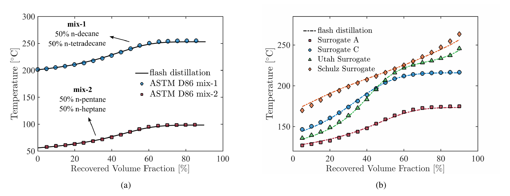

# Thermophysical models

> **Implementation map**
>
> | Concept | Python | MATLAB |
> |---|---|---|
> | Pure-species correlations | `liquid_property` (`thermo_transport/properties.py`) | `ThermophysicalProperties_SingleLiquid.m` |
> | Mixture properties | `mixture_property` | `ThermophysicalProperties_LiquidMixture_speed.m` |
> | Flash equation | `flash_residual` (`distillation/flash.py`) | `Flash.m` |
> | Distillation curve | `distillation_curve` | `DistillationCurve.m` |
> | Early-stopped curve | `distillation_curve_cheap` | `DistillationCurve_cheap.m` |
> | Batch evaluation | `distillation_curve_batch`, `init_pool` | `DistillationCurve_speed.m`, `DistillationCurve_speed_cheap.m` (`parfor`) |
> | Mass fractions, mean weight | `mol_to_mass`, `mol_weight` | `mol2mass.m`, `molWeight.m` |
>
> The formulas and the mixing rules are the same in both implementations; see
> [Differences between the Python and MATLAB implementations](Differences-Python-MATLAB.md).

Implemented in `thermo_transport/properties.py`, `distillation/flash.py` and
`distillation/distillation_curve.py`.

## Pure-species correlations (Yaws)

The correlations and their coefficients are those of the Yaws' handbook ([Yaws 2003](References.md#thermophysical-and-mixing-models)); where the handbook has no coefficients, they were fitted to experimental data or to machine-learning predictions (see [Input data](Input-data.md#what-the-database-contains)).

`liquid_property(prop, T, sp, pressure=101325.0)` returns the liquid-phase property of one species.
`T` can be a scalar or an array. Coefficients come from the species database. `W` is the molecular
weight [g/mol] and `Tc` the critical temperature [K].

| `prop` | Formula | Unit |
|---|---|---|
| `rho` | `1000 * A * B^(-(1 - T/Tc)^C)` | kg/m3 |
| `mu` | `0.001 * 10^(A + B/T + C*T + D*T^2)` | Pa s |
| `nu` | `mu / rho` | m2/s |
| `kappa` | `A + B*T + C*T^2` | W/(m K) |
| `specificHeat` | `1000/W * (A + B*T + C*T^2 + D*T^3)` | J/(kg K) |
| `latentHeat` | `A * (1 - T/Tc)^B / W * 1e6` | J/kg |
| `vaporPressure` | `10^(A + B/T + C*log10(T) + D*T + E*T^2) * 133.322387415` | Pa |
| `sigma` | `A * (1 - T/Tc)^B / 1e3` | N/m |
| `boilingTemperature` | root of `psat(T) - pressure` in `[200, 1200]` K (Brent, `xtol = 1e-6`); independent of `T` | K |

Each property uses its own coefficient set; the numbers of coefficients are 3 for `rho`, 4 for `mu`,
3 for `kappa`, 4 for `specificHeat`, 2 for `latentHeat`, 5 for `vaporPressure` and 2 for `sigma`.
`liquid_property` raises `ValueError` for an unknown name.

`_liquid_property_cached` memoises results on the `Species` object, keyed on property, temperatures
and pressure. This matters because the same species is evaluated thousands of times in a run.

## Mixing rules (`mixture_property`)

`mixture_property(prop, T, X_all, classes, index_n_eta_all, pressure)` returns an array
`(N_samples, N_T)`. With `X_i` molar fractions (the last is `1 - sum`), `W_i` molecular weights:

| `prop` | Mixing rule |
|---|---|
| `rho` | `sum(X_i W_i) / sum(X_i W_i / rho_i)` (ideal mixing of volumes) |
| `mu` | logarithmic: `exp(sum X_i ln mu_i)` |
| `nu` | `mu_mix / rho_mix` |
| `kappa` | Li's method: `sum_i sum_j ψ_i ψ_j K_ij`, with the superficial volume fractions `ψ_i = X_i W_i / rho_i` (normalised to 1) and `K_ij = 2 / (1/k_i + 1/k_j)` |
| `specificHeat`, `latentHeat`, `vaporPressure` | **mass-weighted** average: `sum(X_i W_i prop_i) / sum(X_i W_i)` |
| `sigma` | **mole-fraction** average: `sum(X_i sigma_i)` |

The logarithmic viscosity rule, Li's method for the thermal conductivity and the mole-fraction average of the surface tension follow [Poling et al. (2001)](References.md#thermophysical-and-mixing-models).

Note that `vaporPressure` of the mixture is a mass-weighted average of the pure-species values. It
is not the Raoult's-law sum. The distillation curve does not use this property: it uses the
pure-species vapour pressures directly in the flash equation.

## Flash equation

The distillation curve is obtained from a sequence of flash problems solved with the Rachford-Rice equation ([Rachford and Rice 1952](References.md#thermophysical-and-mixing-models); [Elliott and Lira 2012](References.md#thermophysical-and-mixing-models)). In the notation of the paper the vapour fraction is `β` (`β_f` for the recovered fractions of the targets); `beta` is the same quantity in the code.

`flash_residual(T, beta, classes, index_n_eta, X, pressure)` returns the Rachford-Rice residual

```math
F(T, \beta) = \sum_i x_i \frac{K_i - 1}{1 + \beta (K_i - 1)}, \qquad K_i = \frac{p_{sat,i}(T)}{p}
```

where `x_i` is the liquid composition and `beta` the vapour fraction. The condition `F = 0` gives
the temperature at which a liquid of composition `x` and vapour fraction `beta` are in equilibrium.
Raoult's law is assumed (ideal liquid and vapour).

## Distillation curve

`distillation_curve(X0, classes, index_n_eta, pressure=101325.0)` returns two arrays of 101
points: the recovered volume `volume_fraction` in percent (`0..100`) and the temperature
`T_distillation` in kelvin. It is a batch (differential) distillation computed in 100 flash steps,
as in the MATLAB code:

1. **Initial point.** Solve `F(T, beta = 1e-6) = 0` for `T` starting from 300 K: this is the initial
   bubble temperature (`T_distillation[0]`). Compute the initial liquid volume `V0` from the molar
   volumes `W_i / rho_i` at that temperature.
2. **Steps `ii = 0..99`.** Use `beta = 1/(100 - ii)`, so each step evaporates exactly one hundredth of
   the **initial** moles of liquid. Solve `F(T, beta) = 0` for `T`, starting from the previous
   temperature. Then
   - `K_i = psat_i(T)/p`
   - liquid composition after the step: `x_i <- x_i / (1 + beta (K_i - 1))`
   - vapour composition `y_i = K_i x_i`
   - volume of the vapour condensate `Vtilde = sum(y_i W_i / rho_i)` with densities at `T`
   - `vol_frac[ii+1] = vol_frac[ii] + Vtilde / V0 / 100`
3. **Rescale** `vol_frac` by 100 to the range 0-100.

The last step has `beta = 1`, so the final temperature is the dew point of the residual liquid.

**Root finding.** The bracket is `[T_guess - 100, T_guess + 100]` clipped to `[200, 1200]` K. If
the residual does not change sign, the bracket is widened twice by 100 K on each side, down to
150 K and up to 1500 K. If it still does not bracket a root, the function returns `T_guess`
(no error). The tolerance is `xtol = 0.01` K in the distillation curve (`1e-6` in the standalone
helper `_find_root`).

**Numba.** `numba` is a declared dependency. The root finder and the residual are compiled
(`_find_T_nb`), which is faster than the SciPy path. The import is still wrapped in `try/except`:
if numba cannot be imported, the code falls back to SciPy `brentq`.

**Early-stopped version.** `distillation_curve_cheap(..., vol1)` runs the same procedure and stops as soon
as the recovered volume reaches `vol1`; the remaining entries of `T_distillation` are `NaN`. Used by the
cheap likelihood. The volume axis of this version is `arange(101)`, i.e. a nominal grid, with the
accumulated volume being checked against `vol1` at each step.

## Validation against ASTM D86 data

The flash-distillation model has been validated against experimental ASTM D86 distillation curves: two binary mixtures (50 % n-pentane / 50 % n-heptane and 50 % n-decane / 50 % n-tetradecane by moles; [Ferris and Rothamer 2016](References.md#thermophysical-and-mixing-models)) and hydrocarbon-based surrogate mixtures ([Bruno and Smith 2010](References.md#thermophysical-and-mixing-models)). The comparison is shown in Fig. 8 of [Liberatori et al. (2026)](References.md#statistical-model-and-the-paper), reproduced below.



*Validation of the flash-distillation model against experimental ASTM D86 curves: (a) binary mixtures, (b) surrogate mixtures. Figure 8 of Liberatori et al. (2026).*

## Batch evaluation and worker pool

`distillation_curve_batch(X_all, classes, index_n_eta, pressure)` evaluates the curves of many samples
in parallel with a `multiprocessing` pool:

- `init_pool(n_workers=None, classes=..., batch_size=..., nc=...)` creates a pool with `cpu_count()`
  workers. The species lists are passed once to each worker through the initializer, and four
  `SharedMemory` blocks (inputs `X`, `idx` and outputs `vol_frac`, `T`) avoid pickling the arrays at each call.
- `shutdown_pool()` terminates the pool and releases the shared memory.
- `run_demc` calls `init_pool` at the start (with `batch_size = N_chains`) and `shutdown_pool` at the end.
  The pool is released even if the run raises an exception (`run_demc` is a wrapper with `try/finally`).
- `props_pushforward` and the GSA also use the batch function.

The script that calls `run_demc` must be protected by `if __name__ == "__main__":`, as the example is,
because the pool may use the `spawn` start method (macOS, Windows).

## Mean molecular weight and mass fractions

`utilities/composition.py`:

- `mol_weight(xi, wi) = dot(xi, wi)`;
- `mol_to_mass(xi, wi) = xi * wi / dot(xi, wi)`.

## MATLAB implementation: notes

- **Single-species function.** `ThermophysicalProperties_SingleLiquid(property, T, W, Tcr, Arho, Brho, Crho, Amu, Bmu, Cmu, Dmu, Ak, Bk, Ck, Ac, Bc, Cc, Dc, Ah, Bh, Ap, Bp, Cp, Dp, Ep, Asigma, Bsigma, pressure)`
  takes the coefficients one by one, so the callers pass `sp.coeffRho(1), sp.coeffRho(2), ...` (the unused ones are passed too).
  `Flash.m` calls it with empty arrays for the unused coefficients and vectors for the vapour pressure coefficients.
  The property names are `rho`, `mu`, `nu`, `kappa`, `specificHeat`, `latentHeat`, `vaporPressure`, `boilingTemperature` and `sigma`,
  with the same formulas and units as in the table above.
- **Boiling temperature.** `boilingTemperature` solves `psat(T) - pressure = 0` with `fsolve` starting from 500 K
  (Optimization Toolbox). Python uses Brent's method in `[200, 1200]` K. It is used to compute the temperature threshold in
  `data_import`.
- **Root finding in the distillation curve.** `DistillationCurve` uses `fzero` on a bracket
  `[T_guess - 100, T_guess + 100]` (clipped to `[200, 1200]` K) widened up to three times (to `[150, 1500]` K). The tolerance is the
  default one of `fzero`. If anything fails, the `try/catch` returns `T_guess`. Python uses Brent's method with a tolerance of 0.01 K.
- **Volume normalisation.** `volumeFraction(ii+1) = volumeFraction(ii) + Vtilde/V0` accumulates directly values in
  percent, from 0 to 100. Python divides by 100 and rescales at the end. The result is the same. The header of the
  MATLAB function says "[-]", but the values are in percent.
- **Early-stopped curve.** `DistillationCurve_cheap` stops when the volume reaches `vol1`. The temperatures of the steps not
  computed are `NaN`, the corresponding volumes are `0` (Python: a nominal grid `0..100`). The likelihood discards non-finite pairs, so the
  result does not depend on this.
- **Parallelism.** `DistillationCurve_speed` evaluates one curve per sample with `parfor`; it needs (and starts, if absent)
  a parallel pool. No compiled acceleration is used.
- **Mixture properties.** `ThermophysicalProperties_LiquidMixture_speed(property, T, X_all, classes, index_n_eta_all, pressure)`
  returns an array `N_samples x N_T`. Mixing rules: ideal volume (`rho`), logarithmic (`mu`), `nu = mu/rho`, Li's method
  (`kappa`), mass-weighted (`specificHeat`, `latentHeat`, `vaporPressure`) and mole-fraction-weighted (`sigma`).
